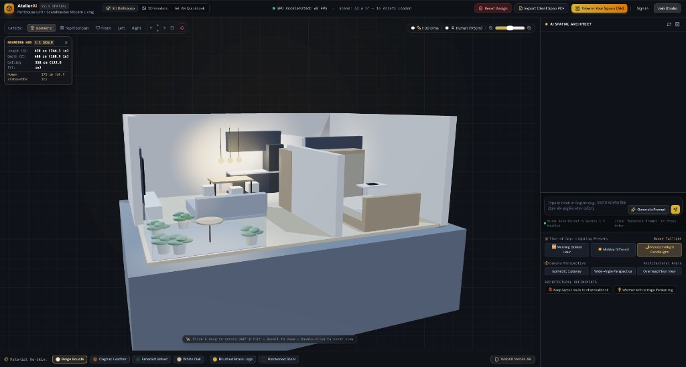
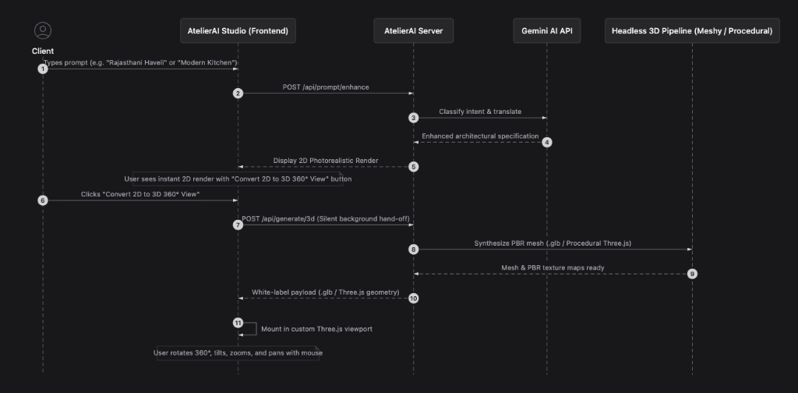

# AtelierAI — 2D & 3D Interactive Spatial Interior Studio

An AI-powered 2D & 3D interior design platform that turns natural language prompts (in English and Hindi) into photorealistic 2D renders and real-time interactive 3D dollhouse models with full 360° circular orbit and multi-directional navigation.

<p align="center">
  
</p>

---

## ✨ Features

- **Multilingual AI Prompt Engine**:
  - Accepts natural language in English and Hindi (Devanagari or Hinglish, e.g., *"कमरे में चारकोल ब्रिक दीवार और आधुनिक सोफा चाहिए"*).
  - Built-in prompt translator and architectural detail enhancer.

- **Dual-View Synthesis (2D $\rightarrow$ 3D)**:
  - Generates high-resolution **2D Photorealistic Architectural Renders** (elevation cutaways and interior perspectives).
  - One-click **"Convert 2D to 3D 360° View"** button to synthesize a procedural Three.js 3D dollhouse model.

- **Dynamic Architectural Archetypes**:
  - **Royal Rajasthani Haveli**: Sandstone pink-yellow facade, ornate jharokha balconies, fresco murals, central chowk with circular stone well, wooden pulley, brass bucket, sacred tulsi chaura, royal diwan lounge, and clay chulha kitchen under golden hour desert sunset.
  - **Luxurious Modern Black Kitchen**: Matte black cabinetry, Calacatta marble waterfall island, 3 modern black bar stools, overhead black chimney hood, pendant lights, and integrated smart appliances.
  - **Mountain Village Snow House**: Timber cabin cutaway, stone hearth fireplace, pine trees, and nocturnal moonlight.
  - **Outdoor Lawn & Patio Lounge**: Teak sundeck, plunge pool, and tropical landscape.
  - **Modern 1BHK Apartment & Duplex Loft**: Heather grey sectional, oak coffee table, glass bathroom, and balcony.

- **Interactive 3D Navigation Controls**:
  - **Left-Click & Drag**: 360° orbital rotation and vertical tilt.
  - **Right-Click / Middle-Click / Shift + Left-Click**: Pan left, right, up, and down across rooms.
  - **Scroll Wheel**: Smooth zoom in and out.
  - **Double-Click**: Instant camera reset.

- **Atmospheric Studio Lighting**:
  - 🌅 Morning Golden Hour (3000 K)
  - ☀️ Midday Diffused (5500 K)
  - 🌙 Moody Twilight Candlelight (Default nocturnal indigo with warm interior fill)

- **Interactive Clean Canvas & Reset**:
  - Reset button to clear the active model and reveal a glowing studio setup with architectural prompt templates.

---

## 🏗️ System Architecture & Native 2D → Interactive 3D Pipeline

<p align="center">
  
</p>

The platform implements a seamless, white-label client-to-engine hand-off:
1. **Natural Language Input**: Client submits a prompt in Hindi, Hinglish, or English.
2. **Gemini NLP & Prompt Engine**: Classifies spatial intent and enriches the request with architectural terminology, materials, camera angles, and diurnal lighting.
3. **2D Photorealistic View**: Synthesizes and displays high-definition architectural elevation/interior cutaways.
4. **Silent Hand-Off & 3D Compilation**: When the client clicks **"Convert 2D to 3D 360° View"**, the server delegates geometry extraction to the headless 3D pipeline in the background.
5. **Interactive Three.js Viewport**: Loads the PBR mesh into the client canvas with full 360° orbit rotation, multi-directional panning, and real-world spatial measurements.

---

## 🛠️ Tech Stack

- **Frontend**: HTML5, Tailwind CSS, Three.js (r125), Lucide Icons, WebGL
- **Backend**: Node.js, Express.js
- **APIs & AI**: Google Gemini API for multilingual enhancement, procedural Three.js geometry engine, RESTful generation routes

---

## 🚀 Getting Started

### 1. Prerequisites
- [Node.js](https://nodejs.org/) (v18 or higher recommended)
- `npm` or `yarn`

### 2. Installation
Clone the repository and install dependencies:

```bash
git clone https://github.com/Sankalp28Roop/Interior-Designer-2D-and-3D.git
cd Interior-Designer-2D-and-3D/server
npm install
```

### 3. Environment Setup
Configure your environment variables in `server/.env`:

```env
PORT=5050
NODE_ENV=development
JWT_SECRET=your_jwt_secret
GEMINI_API_KEY=your_gemini_api_key
```

### 4. Running the Application
Start the server daemon:

```bash
cd server
node src/server.js
```

Open your browser and navigate to:
```
http://localhost:5050/studio/code.html
```

---

## 📂 Project Structure

```text
├── 3D_interior/
│   └── atelierai_interactive_3d_spatial_studio/
│       └── code.html              # Main interactive 3D studio application
├── server/
│   ├── public/                    # Synthesized 2D/3D render assets & textures
│   │   ├── kitchen_2d_eye_level.jpg
│   │   ├── kitchen_3d_cutaway_isometric.jpg
│   │   ├── rajasthani_haveli_2d.jpg
│   │   ├── rajasthani_haveli_3d.jpg
│   │   └── modern_1bhk_dollhouse.jpg
│   ├── src/
│   │   ├── server.js              # Express API server & static hosting
│   │   ├── routes/                # Prompt, render, and asset extraction routes
│   │   └── services/              # Gemini prompt enhancer and analysis engine
│   └── package.json
└── README.md
```

---

## 📄 License
This project is licensed under the MIT License.
